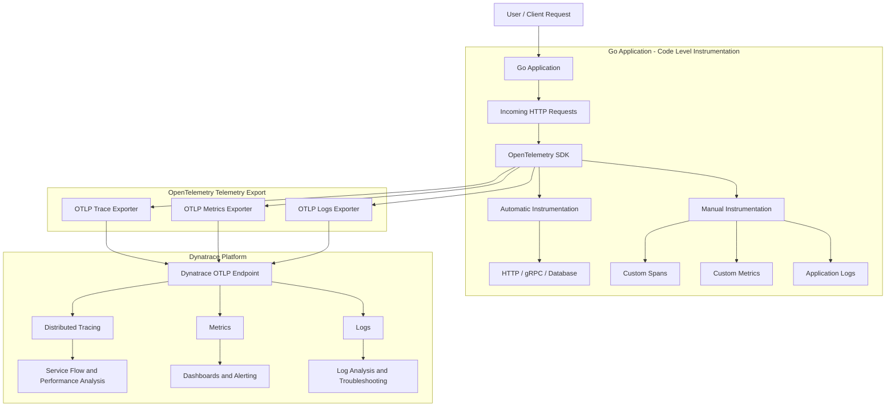
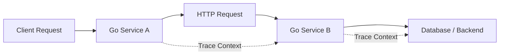
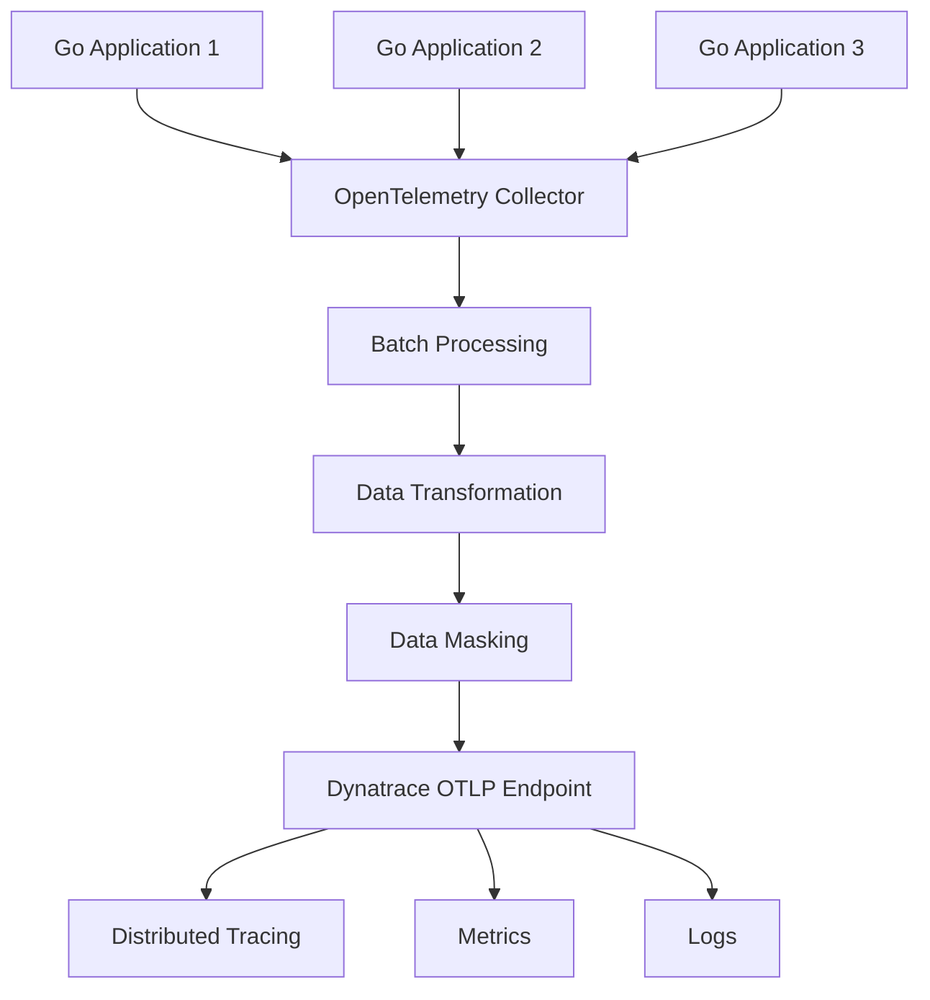

# Go Application Code-Level Monitoring with Dynatrace

### OpenTelemetry (OTel) Integration | Distributed Tracing | Metrics | Logs

**Author:** Gajanan Kalkundre  
**Technology:** Go | OpenTelemetry | Dynatrace | OTLP  
**Document Version:** 1.0  

---

## 1. Project Overview

This project demonstrates how to integrate a Go application with Dynatrace using OpenTelemetry (OTel) to achieve application-level monitoring and distributed tracing.

The integration enables Go applications to send telemetry data directly to Dynatrace through the OpenTelemetry Protocol (OTLP).

Unlike basic infrastructure monitoring, code-level instrumentation provides deeper visibility into application execution, including individual requests, business transactions, service dependencies, application metrics, and logs.

### Key Objectives

- Enable code-level tracing for Go applications.
- Integrate OpenTelemetry with Dynatrace.
- Capture incoming and outgoing HTTP requests.
- Monitor application transactions using custom spans.
- Collect application-level metrics.
- Forward application logs to Dynatrace.
- Enable distributed tracing across multiple services.
- Troubleshoot application performance and failures.

## 2. Solution Architecture

The following architecture represents the Go application monitoring implementation using OpenTelemetry and Dynatrace.

### High-Level Architecture



### Architecture Components

| Component | Description |
|---|---|
| Go Application | Application that requires code-level monitoring |
| OpenTelemetry SDK | Generates and manages application telemetry |
| Automatic Instrumentation | Captures supported library operations with minimal code changes |
| Manual Instrumentation | Adds custom spans and business-level tracing |
| OTLP Exporter | Sends traces, metrics, and logs to Dynatrace |
| Dynatrace OTLP Endpoint | Receives telemetry data |
| Dynatrace Platform | Provides distributed tracing, metrics, logs, and application visibility |

### Data Flow

1. A user sends a request to the Go application.
2. OpenTelemetry captures the incoming request.
3. Application instrumentation generates spans, metrics, and logs.
4. The telemetry data is processed by the OpenTelemetry SDK.
5. OTLP exporters send the data to the Dynatrace endpoint.
6. Dynatrace receives and processes the telemetry.
7. Application performance and dependencies become available for analysis.

---

## 3. Monitoring Capabilities

The integration supports the following telemetry signals:

| Telemetry | Supported | Benefits |
|---|---|---|
| Distributed Traces | Yes | Request-level visibility and transaction analysis |
| Application Metrics | Yes | Application performance and custom metric monitoring |
| Application Logs | Yes | Centralized application log analysis |
| Custom Spans | Yes | Visibility into individual business operations |
| Trace Context Propagation | Yes | Correlation across multiple services |

## 4. Prerequisites

Before starting the integration, ensure the following requirements are fulfilled.

| Component | Requirement |
|---|---|
| Dynatrace Environment | Version 1.222 or later |
| Go | Version 1.20 or later |
| OpenTelemetry | Go SDK and OTLP exporters |
| Dynatrace Access | Admin or API token creation permission |
| Authentication | Dynatrace API access token |
| Network | Outbound connectivity to Dynatrace OTLP endpoint |
| Trace Context | W3C Trace Context enabled |

### Enable W3C Trace Context

In Dynatrace:

1. Navigate to Settings.
2. Open Collect and capture.
3. Navigate to General monitoring settings.
4. Open OneAgent features.
5. Enable Send W3C Trace Context HTTP headers.

For Classic environments, the setting may be available under Settings → Preferences → OneAgent features.

W3C Trace Context enables trace correlation across supported application and service boundaries.

---

## 5. Dynatrace OTLP Configuration

### 5.1 Determine the OTLP Endpoint

The OTLP base URL depends on your Dynatrace deployment.

| Environment | OTLP Endpoint |
|---|---|
| Dynatrace SaaS | `https://{environment-id}.live.dynatrace.com/api/v2/otlp` |
| Environment ActiveGate | `https://{activegate-domain}:9999/e/{environment-id}/api/v2/otlp` |
| Containerized Environment ActiveGate | `https://{activegate-domain}/e/{environment-id}/api/v2/otlp` |

**Important:** For Dynatrace SaaS, use the correct environment hostname ending in `live.dynatrace.com`. Do not use `live.apps.dynatrace.com` in the OTLP endpoint.

### 5.2 Create Dynatrace API Token

Navigate to Dynatrace → Access Tokens.

Create an API token with the following scopes:

| Telemetry | Required Token Scope |
|---|---|
| Traces | `openTelemetryTrace.ingest` |
| Metrics | `metrics.ingest` |
| Logs | `logs.ingest` |

Store the API token securely using environment variables or a secrets manager.

Never hardcode production API tokens in application source code.

---

## 6. OpenTelemetry Integration in Go

### 6.1 Install Dependencies

Add the required OpenTelemetry packages to the Go application.

```bash
go mod tidy
```

The implementation uses the following packages:

| Package | Purpose |
|---|---|
| `go.opentelemetry.io/otel` | OpenTelemetry API |
| `go.opentelemetry.io/otel/sdk` | OpenTelemetry SDK |
| `otlptracehttp` | Export distributed traces |
| `otlpmetrichttp` | Export application metrics |
| `otlploghttp` | Export application logs |
| `otelhttp` | Automatic HTTP instrumentation |
| `propagation` | Trace context propagation |
| `github.com/Dynatrace/OneAgent-SDK-for-Go/sdk` | Dynatrace enrichment metadata |

### 6.2 Import Required Packages

Example imports:

```go
import (
    "context"
    "log"
    "log/slog"
    "time"

    "github.com/Dynatrace/OneAgent-SDK-for-Go/sdk"

    "go.opentelemetry.io/otel"
    "go.opentelemetry.io/otel/attribute"
    "go.opentelemetry.io/otel/propagation"
    "go.opentelemetry.io/otel/trace"

    "go.opentelemetry.io/otel/exporters/otlp/otlptrace/otlptracehttp"
    "go.opentelemetry.io/otel/exporters/otlp/otlpmetric/otlpmetrichttp"
    "go.opentelemetry.io/otel/exporters/otlp/otlplog/otlploghttp"
)
```

### 6.3 Initialize OpenTelemetry

Create an initialization function to configure the OpenTelemetry SDK and Dynatrace exporters.

The initialization process includes:

1. Configure Dynatrace endpoint and authentication.
2. Initialize the Dynatrace OneAgent SDK instance.
3. Retrieve Dynatrace enrichment metadata.
4. Configure service name and version.
5. Initialize the trace exporter.
6. Initialize the metrics exporter.
7. Initialize the logs exporter.
8. Configure W3C trace context propagation.

Example configuration:

```go
func InitOpenTelemetry() {

    ctx := context.Background()

    // Dynatrace configuration
    dtAPIHost := "YOUR_DYNATRACE_HOST"
    dtAPIBasePath := "/api/v2/otlp"

    dtAPIToken := "LOAD_FROM_SECURE_SECRET"

    authHeader := map[string]string{
        "Authorization": "Api-Token " + dtAPIToken,
    }

    // Initialize Dynatrace SDK
    oneAgentSDK := sdk.CreateInstance()
    dtMetadata := oneAgentSDK.GetEnrichmentMetadata()

    // Configure OpenTelemetry resource
    // Add service name, version and Dynatrace metadata.

    // Initialize OTLP trace exporter
    // Initialize OTLP metrics exporter
    // Initialize OTLP logs exporter

    // Configure W3C Trace Context propagation

}
```

**Note:** The above is an initialization outline. Configure each exporter with the appropriate OTLP endpoint, headers, resource, and provider as described in the implementation sections below.

### 6.4 Configure OTLP Exporters

The implementation uses three separate HTTP exporters.

| Exporter | Endpoint |
|---|---|
| Trace Exporter | `/api/v2/otlp/v1/traces` |
| Metrics Exporter | `/api/v2/otlp/v1/metrics` |
| Logs Exporter | `/api/v2/otlp/v1/logs` |

All exporters use the Dynatrace API token for authentication.

The endpoint configuration follows this pattern:

```go
otlptracehttp.WithEndpoint(dtAPIHost)
otlptracehttp.WithURLPath(dtAPIBasePath + "/v1/traces")
otlptracehttp.WithHeaders(authHeader)
```

Equivalent configuration is applied to the metrics and logs exporters using their respective exporter packages.

**Important:** The Dynatrace OTLP ingestion endpoint in this implementation uses HTTP exporters. Do not configure the direct Dynatrace endpoint as an OTLP gRPC endpoint.

### 6.5 Initialize OpenTelemetry in Main Function

Call the initialization function at the beginning of the application startup, before registering HTTP handlers.

```go
func main() {

    InitOpenTelemetry()

    // Register application handlers
    // Start application server

}
```

For production, ensure that the trace, metric, and log providers are flushed and shut down gracefully when the application terminates.

---

## 7. Automatic Instrumentation

Automatic instrumentation helps capture supported application operations with minimal code changes.

For HTTP applications, the OpenTelemetry HTTP instrumentation package can be used.

### Example: HTTP Instrumentation

Import:

```go
import (
    "net/http"

    "go.opentelemetry.io/contrib/instrumentation/net/http/otelhttp"
)
```

Wrap the HTTP handler:

```go
handler := http.HandlerFunc(httpHandler)

wrappedHandler := otelhttp.NewHandler(
    handler,
    "my-span",
)

http.Handle("/", wrappedHandler)
```

### Benefits

- Capture incoming HTTP requests.
- Generate request-level spans.
- Capture request execution time.
- Support trace context propagation.
- Improve visibility into application endpoints.

Other instrumentation packages can be selected from the OpenTelemetry Go instrumentation registry for supported gRPC and database libraries.

---

## 8. Manual Instrumentation

Manual instrumentation is useful when additional visibility is required into specific business operations or application logic.

### 8.1 Custom Distributed Tracing

Create a tracer and start a custom span.

```go
tracer := otel.Tracer("my-tracer")

_, span := tracer.Start(
    r.Context(),
    "Call to /myendpoint",
)

defer span.End()

span.SetAttributes(
    attribute.String("http.method", "GET"),
    attribute.String("net.protocol.version", "1.1"),
)

// Execute business logic
```

This allows individual business operations to be identified and analysed in Dynatrace.

### 8.2 Custom Application Metrics

Create a custom counter to monitor application requests.

```go
meter := otel.Meter("my-meter")

requestCounter, _ := meter.Int64Counter(
    "request_counter",
)

requestCounter.Add(
    context.Background(),
    1,
)
```

Custom metrics can be used to monitor application-specific activities.

### 8.3 Application Log Integration

The implementation uses OpenTelemetry logging integration with Go's standard `slog` logger.

Example:

```go
slog.Info("Application started")

slog.Debug("Processing request")

slog.Error("Application error")
```

These logs can be exported to Dynatrace through the configured OTLP log exporter.

---

## 9. Distributed Trace Context Propagation

Trace context propagation is important when multiple services communicate with each other.

It allows Dynatrace to correlate requests across different application components and services.

### Architecture



### 9.1 Extract Incoming Trace Context

Extract the existing trace context from incoming HTTP headers.

```go
parentCtx := otel.GetTextMapPropagator().Extract(
    r.Context(),
    propagation.HeaderCarrier(r.Header),
)
```

Start a span using the extracted context:

```go
tracer := otel.Tracer("my-tracer")

ctx, span := tracer.Start(
    parentCtx,
    "manual-server",
)

defer span.End()
```

### 9.2 Inject Trace Context into Outgoing Requests

Before sending an outgoing HTTP request, inject the current trace context into the request headers.

```go
otel.GetTextMapPropagator().Inject(
    ctx,
    propagation.HeaderCarrier(req.Header),
)
```

This helps maintain trace correlation between upstream and downstream services.

---

## 10. Dynatrace Data Privacy and Attribute Redaction

Dynatrace can ingest OpenTelemetry attributes, but attribute values displayed in the UI are subject to attribute allowlisting and privacy configuration.

Before using custom attributes for troubleshooting or dashboards:

1. Review the attribute redaction settings.
2. Configure the required attribute allowlist.
3. Validate that the required attributes are visible.
4. Avoid sending sensitive information such as passwords, authentication tokens, or personal data.

Reference: Dynatrace Attribute Redaction.

---

## 11. Verify Telemetry Data in Dynatrace

After completing the integration, generate a few application requests and verify that the telemetry is reaching Dynatrace.

| Signal | Dynatrace Location | Expected Result |
|---|---|---|
| Traces | Distributed Tracing → Explorer | Incoming requests and spans |
| Metrics | Metrics | Custom application metrics |
| Logs | Logs & Events Classic | Application log records |

### Trace Verification

1. Generate traffic against the Go application.
2. Open Dynatrace.
3. Navigate to Distributed Tracing.
4. Open Explorer.
5. Select the relevant time range.
6. Search for the configured service name.
7. Open individual traces.
8. Validate request execution and custom spans.

### Metrics Verification

1. Navigate to Metrics.
2. Search for the custom metric `request_counter`.
3. Validate the metric values.
4. Confirm that metrics are being updated.

### Logs Verification

1. Navigate to Logs & Events Classic.
2. Search for application log messages.
3. Verify that INFO, DEBUG, and ERROR messages are available as configured.

Allow a few minutes for initial telemetry ingestion.

---

## 12. Troubleshooting

| Issue | Possible Cause | Resolution |
|---|---|---|
| HTTP 404 during export | Incorrect Dynatrace endpoint | Verify the hostname and `/api/v2/otlp` path |
| HTTP 401 / 403 | Invalid token or missing permissions | Verify API token and required ingestion scopes |
| Traces not linked across services | Trace context propagation is missing | Enable W3C Trace Context and implement context extraction/injection |
| OTLP gRPC export fails | Direct Dynatrace endpoint requires HTTP in this implementation | Use OTLP HTTP exporters or an OpenTelemetry Collector |
| No metrics available | Metrics exporter or provider configuration issue | Validate metrics endpoint, token scope, and exporter initialization |
| No logs available | Logs exporter or logger provider configuration issue | Verify log exporter and `slog` integration |
| Custom attributes missing | Attribute allowlist or privacy configuration | Review Dynatrace attribute redaction settings |
| No application traces | No instrumentation or no application traffic | Verify instrumentation and generate test requests |

---

## 13. Alternative Architecture: OpenTelemetry Collector

For larger environments with multiple Go applications, telemetry can be routed through an OpenTelemetry Collector instead of configuring every application to export directly to Dynatrace.

### Collector-Based Architecture



### Benefits of Collector Architecture

- Centralized telemetry management.
- Batch processing and improved export management.
- Data transformation.
- Data masking and filtering.
- Single outbound network connection point.
- Simplified management for multiple applications.

---

## 14. Final Implementation Checklist

- [ ] Dynatrace environment prerequisites verified.
- [ ] Go version verified.
- [ ] Dynatrace OTLP endpoint configured.
- [ ] API token created with required scopes.
- [ ] W3C Trace Context enabled.
- [ ] OpenTelemetry dependencies installed.
- [ ] Dynatrace SDK enrichment metadata configured.
- [ ] Trace exporter configured.
- [ ] Metrics exporter configured.
- [ ] Logs exporter configured.
- [ ] Automatic instrumentation implemented where required.
- [ ] Manual spans implemented.
- [ ] Trace context propagation validated.
- [ ] Traces visible in Dynatrace.
- [ ] Metrics visible in Dynatrace.
- [ ] Application logs visible in Dynatrace.

---

## 15. References

Official documentation and implementation references:

1. [Dynatrace OneAgent SDK for Go](https://github.com/Dynatrace/OneAgent-SDK-for-Go)
2. [Instrument Your Go Application with OpenTelemetry](https://docs.dynatrace.com/)
3. [OpenTelemetry Go Documentation](https://opentelemetry.io/docs/languages/go/)
4. [OpenTelemetry Go Instrumentation Registry](https://opentelemetry.io/ecosystem/registry/?language=go)
5. [Dynatrace OTLP API Endpoints](https://docs.dynatrace.com/docs/ingest-from/opentelemetry/otlp-api)
6. [Dynatrace API Tokens and Authentication](https://docs.dynatrace.com/)
7. [OpenTelemetry Collector](https://opentelemetry.io/docs/collector/)

---

## 16. Project Summary

By integrating OpenTelemetry with Dynatrace, Go applications can achieve deeper application-level observability beyond infrastructure monitoring.

The solution provides visibility into:

- Distributed request execution.
- Application business transactions.
- Service dependencies.
- Application performance metrics.
- Application logs.
- Errors and failures.
- End-to-end trace correlation.

This approach helps development and monitoring teams identify application bottlenecks, investigate failures, and improve overall application performance.

---

**Implementation:** OpenTelemetry and Dynatrace OTLP Integration
